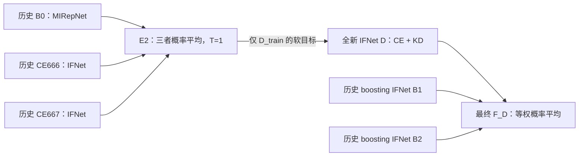

# E2 → 新 IFNet 蒸馏 → 与 B1、B2 软投票：LOSO pilot

日期：2026-11-05。版本：`E2_IFNET_DISTILL_BOOST_ENSEMBLE_LOSO_V1`。

状态：实验设计。已只读核对 AdaBoost 实际配置、结果、逐折概率缓存和权重覆盖；本版 runner/config 尚未创建，未执行本版 smoke、入队或训练。下述新增参数是预先固定的 pilot 起点，未验证最优性。

## 1. 固定流程与问题

用户确认的流程是：

**冻结 E2（MIRepNet B0 + CE666 + CE667 的等权概率平均）→ 从未训练状态蒸馏一个新 IFNet D → 将 D 与历史 AdaBoost 学习器 B1、B2 等权软投票。**

分别回答三个问题：

1. D 单独预测是否优于同初态的新 CE 学生 C？
2. D+B1+B2 是否优于 C+B1+B2，即蒸馏是否比简单增加第三个 CE 学生有价值？
3. 最终三个 IFNet 的组合，是否达到或超过原 E2、E4；同时如何改变推理所需的模型组成？

最终组合称为“蒸馏学生与 boosting 学习器的软投票”。旧 AdaBoost 的 alpha 绑定原 B0→B1→B2 训练顺序，本版不把原 alpha0 移给 D。单独 D 是一个 IFNet，最终组合是三个 IFNet，二者分别报告性能和成本。

当前数据集的目标成绩已被多轮查看，E2 也依据已有结果被选作研究对象。本版属于探索性后续，不能描述为整个研究过程未见过目标结果。锁定本版配置后，不用新目标成绩选择温度、lambda、epoch、投票权重或模型版本。

## 2. 真实参考与产物覆盖

历史运行：`adaboost_bnci2014004_seed666_v1`。九目标被试等权 Accuracy 为：B0 76.27%、CE666 74.03%、E2 75.58%、E4 74.95%、B1 72.50%、B2 69.51%。这些是旧参考，不是新蒸馏结果。

本次只读核对的覆盖：

| 材料 | 覆盖 | 实施意义 |
|---|---:|---|
| E2 成员 B0/CE666/CE667 的 train、feedback、test 概率及 UID/y | 9/9 折 | 可直接构造原始 E2 软目标 |
| E2 本身的三分区概率 | 9/9 折 | 与三成员 T=1 概率均值最大误差不超过 1.2e-7 |
| B1/B2 三分区概率及 UID/y | 18/18 学习器 | 能在原有 trial 上离线计算新组合 |
| 历史 B0 checkpoint | 9/9 折 | 可追溯、必要时只读推理 |
| CE666/CE667 checkpoint | 18/18 | 可追溯、必要时只读推理 |
| B1/B2 checkpoint | **0/18** | 原 runner 完成后清理，现阶段不能对新 trial 部署完整组合 |
| B1/B2 小 completion 记录、history | 18/18 | 保留身份及训练记录；不等同于模型权重 |
| split/UID manifest | 9/9 折 | 固定 7/1/1 划分 |
| CE666/667/668 的 100epoch UID schedule | 各 9/9 折 | 新学生可复用相同 UID 序列 |
| 独立未训练 IFNet 初态文件 | 未发现 | 本版实际生成并保存 I_s，不假设历史初态文件存在 |

核心外部概率路径：

`/data1/llx/BigSmallcollab/weights/adaboost_loso/adaboost_bnci2014004_seed666_v1/folds/S01/predictions.npz`，被试目录为 S01–S09。

字段包括 `train_uids/train_y`、`train_{B0,CE666,CE667,B1,B2,E2}_probabilities`；`feedback_*`、`test_*` 同结构。该归档没有 raw logits，不能把现有概率加 clamp 后取 log 冒充原始 logits。

身份依据：`results/loso/adaboost/adaboost_bnci2014004_seed666_v1/{run_config,reuse_manifest}.json` 和各折 `fold_manifest.json`。教师必须引用该运行实际 B0：七源被试、10epoch、历史 lr=0.001。不能用当前模型 YAML 或 adaptive-weight tune 的 lr=0.0001 教师替换。

**首轮能够完成全部离线准确率比较。B1/B2 缺权重不妨碍在已保存 UID 上合成概率，但妨碍部署到新 trial。** 缺权重不触发隐式重训；若后续需要可部署完整组合，按第 10 节单列恢复工作。

## 3. 数据、预处理与 seed

| 项目 | 首轮设置 |
|---|---|
| 数据 | BNCI2014004 / 004，session_3（历史别名 3test），左右手二分类 |
| 源版本 | `/data1/llx/BNCI2014004/wide_fre_band/`，沿用已核验 source hash |
| 每折 | 7 源训练被试 D_train + 1 源反馈被试 D_feedback + 1 目标被试 D_test |
| split | 原样复用历史九折 UID manifest，不重新抽分 |
| 冻结模型包 | 历史 experiment_seed=666 的 B0/CE666/CE667/B1/B2，每折各一包 |
| 新学生 pilot | student_seed=668；9 个目标被试，三条训练分支 C/K/D |
| 后续学生重复 | 固定配置补 student_seed=666、667，形成 666/667/668；本批不自动扩展 |
| Student 输入 | 历史 IFNet 原生 3 通道、4 秒、250 Hz，4–16 / 16–40 Hz 双频带；无 EA |
| 教师软目标输入 | 历史 B0 用 8–30 Hz、逐被试 EA、45 通道映射；CE 成员用 IFNet 自己的输入 |

首轮 668 不是 E2 的两个 CE 成员 seed。扩展时即使 student_seed 与 CE 成员同号，也只加载实际保存的未训练 I_s，不加载成员训练后参数、BN 或 optimizer。各条件读取同一个 I_s、同一 UID schedule 和学生 Dropout RNG；保存实际初态 hash 和全部派生种子。

固定历史模型包意味着后续三个 student seed 仅考察新学生初始化随机性，不能称三套独立教师/boosting 运行。报告同时写 `n_student_seed`、`teacher_bundle_seed=666`、`n_teacher_bundle_per_fold=1`、`n_subject=9`。

数据边界：

- D_train：三条新学生的梯度、CE 标签、KD 软目标唯一来源。
- D_feedback：epoch1/10/50/100 的只读诊断，不训练、不早停、不选择投票权重或超参数。
- D_test：新条件全部终点锁定后统一评测。旧目标概率已经存在，训练模块仍不加载这些数组。

历史 E2 的目标预测包含 B0 对目标被试全部无标签 trial 做 EA。新 D、K、C 以及 B1/B2 的 IFNet 推理均不需要目标被试跨 trial 统计。因此表注必须区分：**B0/E2/E4 是含目标无标签 EA 的历史参考；本版新 IFNet 及其最终三 IFNet 组合保持无 EA 的零校准输入。** 不能把与 E2 的差值全部归因于学生容量，也不能把不同输入条件混称同一设置。

E2 的训练软目标来自成员已经见过的源训练 UID，可能高置信或过拟合。这属于训练内教师预测，未使用目标试验；本轮不额外引入交叉拟合、新数据或目标域适配。

## 4. 精确定义 E2 软目标和训练损失

对同一源训练 trial UID x，冻结的三成员 T=1 概率为 p_B0、p_CE666、p_CE667：

\[
q_{E2}(x)=\tfrac13[p_{B0}(x)+p_{CE666}(x)+p_{CE667}(x)].
\]

只导出 train 分区到独立、不可变的训练 target cache。逐项校验 UID、标签、类别顺序（left=0/right=1）、概率 shape [N,2]、有限性、非负性和每行概率和（绝对误差≤1e-6）；重算 E2 与历史 E2 的逐元素最大误差≤1e-6。缓存均值计算沿用历史 float64，再转 fp32 用于训练，记录实际误差及 hash。

本版固定 **T=1**，直接压缩当前 E2 概率分布。不会把“先对每个成员 logits 加温再平均”和“对 E2 概率再加温”混为同一种方法；T>1 另设版本。

对新学生 logits z，p=softmax(z)，定义每样本 KL 对类别求和、再对实际 batch 样本数求平均：

\[
L_{KD}(q,z)=\frac1B\sum_i\sum_{c=1}^2q_{ic}(\log q_{ic}-\log p_{ic}),\quad 0\log0=0.
\]

| 训练条件 | 定义 | 目的 |
|---|---|---|
| `NEW_CE`，简称 C | CE(z_C,y) | 同初态监督基线 |
| `B0_KD`，简称 K | CE(z_K,y) + 0.5 KL(p_B0 || p_K) | 单 MIRepNet 教师、相同 T=1 的蒸馏对照 |
| `E2_KD`，简称 D | CE(z_D,y) + 0.5 KL(q_E2 || p_D) | 用户提出的集成教师蒸馏 |

三分支的 CE 都使用全部 D_train 真实标签；教师概率停止梯度；新学生的原骨干和原分类头全更新。本版没有样本重加权、feature loss、MCC、RL 或 teacher adaptation。

## 5. 新 IFNet 的固定训练设置

| 参数 | 值 |
|---|---|
| 终点 / KD 启用 | 最终 epoch100；K/D 从 epoch1 启用，无纯 CE warmup |
| optimizer | AdamW，lr=0.001，weight_decay=0.01 |
| betas / eps | (0.9,0.999) / 1e-8；amsgrad=False |
| foreach / fused | False / False |
| scheduler | epoch-end CosineAnnealingLR，T_max=100，eta_min=0 |
| batch | 16，最后不足 batch 保留，以实际 B 平均 |
| 精度 / 梯度累积 | fp32 / 1 |
| 梯度裁剪 | 沿用原 IFNet 无裁剪；非有限 loss/gradient 失败并记录 |
| 标签平滑 / 类别权重 / 新增增强 | 0 / 无 / 无 |
| 模式 | train 保留原 BN/Dropout；只读推理走历史原生分类路径 |
| DataLoader workers / CPU线程 | 0 / 每进程 1 |

这些训练参数除本版 T=1、KD 权重与启用时点外，继承经审计的历史 IFNet 配置。实际实施保存完整 resolved config，不能靠当前 YAML 默认值推断历史身份。

新建并实际保存每折未训练 I_s（含分类头、BN）及各独立 RNG 初态。优先复用 seed668 已保存的 100epoch 原始 UID schedule，先验证训练 UID 集、每 epoch 覆盖及 batch顺序；C/K/D 分别恢复同一学生 RNG。KD target 读取与诊断不消耗学生 Dropout/data RNG。三分支每个 batch 都只调用一次学生 forward。

历史 CE668 可列为非配对参考。本版重跑 C，避免把只有配置相同、初始化/RNG 轨迹未确认的旧模型当严格配对基线。新训练不会继续历史 CE 的训练后状态。

## 6. 最终软投票与必要对照

在三条新学生终点固定后，按相同目标 trial UID 配对各模型的 T=1 概率：

\[
p_{12}=\tfrac12(p_{B1}+p_{B2}),\qquad
p_{F_X}=\tfrac13(p_X+p_{B1}+p_{B2}),\quad X\in\{C,K,D\}.
\]

最终预测均为 argmax，若二分类概率精确平票，固定选编码0并单列平票数。全程等权，未拟合投票参数。

| 报告条件 | 来源 | 新增训练 |
|---|---|---:|
| B0、CE666、E2、E4、B1、B2 | 历史参考与对应概率 | 0 |
| `B1_B2_SOFT` | B1+B2 等权软投票 | 0 |
| `NEW_CE`、`B0_KD`、`E2_KD` | 新 C/K/D 各自单模型 | 每折 3 条 |
| `NEW_CE_B1_B2_SOFT` = F_C | 新 C+B1+B2 | 0，预测合成 |
| `B0_KD_B1_B2_SOFT` = F_K | 新 K+B1+B2 | 0，预测合成 |
| `E2_KD_B1_B2_SOFT` = F_D | 新 D+B1+B2；用户指定最终方法 | 0，预测合成 |

F_D−F_C 检验蒸馏对最终集成的作用；F_D−F_K 检验集成教师相对单教师的作用；F_D−B1_B2_SOFT 检验加入 D 后的变化。只比较 F_D 与单个 CE，会把增加成员与蒸馏两个因素混在一起。

## 7. 评测、诊断与预定判读

主指标为每目标被试 Accuracy (%) 的等权平均。另报 BA、Kappa、CE、每类 recall、预测数量和 collapse。二分类这批 trial 的 Accuracy 与 BA 数值可能相同，仍按指标实际计算、分别标注。

预定主要比较：

1. F_D − F_C：最终组合是否获得超出新增 CE 学生的收益。
2. F_D − E2：三个 IFNet 是否达到或超过原软投票参考，注明原 E2 的目标 EA 条件。

关键次要比较：D−C、D−K、F_D−F_K、F_D−E4、F_D−B1_B2_SOFT、F_D−D。固定报告全部比较，不按结果删选。

统计单位为九个 LOSO 目标被试。首轮 `n_student_seed=1 (668)`；每项报告九被试差值、等权均值、W/T/L、10000次被试配对 bootstrap 95%CI，seed=20261105，同一索引表用于所有比较，tie阈值1e-6 pp。首轮不报告 p 值。LOSO 源训练集重叠，区间用于探索性描述，不把 trial 当独立重复。若后续扩展三个学生 seed，先在目标被试内平均 seed，再对九被试配对；如展示 mean±SD，先在每个 seed 内平均九被试，再计算三个学生 seed 宏平均的样本 SD，明确固定教师包没有独立重复。单 seed 不报告跨 seed SD。

epoch1/10/50/100 只在 train/feedback 诊断 CE、KL、预测熵、原分类头 Accuracy/BA、D 与 E2 一致率。E2 在 train/feedback 上的 CE/熵/Accuracy 同时报告，用来描述训练内软目标，不据此改参数或选 epoch。只读诊断必须保存/恢复模型模式、状态和 RNG；特别防护 IFNet 的约束分类层在 eval forward 进行 renorm。

目标集终点评估增加：C/D 与 B1/B2 的预测一致率、两两错误交集、oracle准确率及组合相对最佳成员的增益。这些只作结果解释，不用于重新定权或选成员。

判读预先约定：

- D−C 正向：单 IFNet 的点估计改善；CI 包含0时保留不确定性。
- F_D−F_C 正向：与额外加入同初态 CE 模型相比，蒸馏后组合有正向差；CI 全大于0才报告本 pilot 内较明确的正向证据。
- F_D 高于 E4、低于 E2：超过本历史 AdaBoost 配置，仍未超过原简单软投票。
- F_D 提升而 D 不提升：只支持组合结果改善，不能宣称部署单学生已受益。
- F_D 与 E2 差距较小：报告实际差值/区间及模型组成，不以“CI包含0”宣称等效。
- 相似度或 KL 下降而目标 Accuracy 不升：不认定蒸馏成功。

## 8. 实施验收与异常处理

下列为未来实现要求，本次未运行：

- 九折 split/UID/类别及输入哈希一致；同一原始 trial 经各模型专用预处理后仍按 UID 配对。
- 构造 E2 仅读取 train 字段，训练 target cache 不含 test UID/概率；反馈字段单独保存。所有读取的 partition/UID hash 留痕。
- 从归档重算 E2 概率，验证与历史 E2一致；现有离线预测还原 E2/E4 指标，Accuracy误差不超过1e-6 pp，超出则停止调查。
- C/K/D 初始 state、BN、学生 RNG、100epoch schedule 相同；三优化器分别从零初始化。
- 用同一个训练 loss dispatch 做 train-only 短 smoke：KL公式、只有学生有梯度、lambda=0 跳过 teacher 分支并退化为 CE 相同步骤。
- resume 恢复 model/optimizer/scheduler、全部 RNG、epoch/batch游标；后续步骤可复现，不拼接不同配置。
- 读取旧概率的 reader 不要求 B1/B2 已删除权重存在，不因缺权重启动训练；新报告明确 offline probability composition。
- 新 D 脱离 E2/B1/B2 单独加载原 IFNet 推理路径，重现其保存的目标 logits；完整三模型新trial部署检查在权重恢复后完成。
- 数值、哈希、UID 或模型来源不一致则列清单停止该批；不换教师、不补成0、不静默改训练参数。

## 9. 预算与分阶段执行

| 工作 | 首轮 student_seed668 | 后续补666/667额外 |
|---|---:|---:|
| 新 IFNet C：100epoch | 9 | 18 |
| 新 IFNet K：100epoch | 9 | 18 |
| 新 IFNet D：100epoch | 9 | 18 |
| 新训练总计 | **27** | **54** |
| E2/B0/历史CE重训 | 0 | 0 |
| B1/B2重训 | 0，离线概率复用 | 0，仍固定同一历史包 |
| 最终投票训练 | 0 | 0 |

首轮顺序：产物身份清单 → 固定 train-only smoke → 九折 C/K/D 配对训练 → 全部终点锁定 → 统一目标评测与离线组合 → 汇报。是否投入后续重复依据预定比较的完整结果决定，不改变已经执行的首轮参数。

执行时按折提交独立共享队列任务，一个任务完成该折 C/K/D；最多九折并行，避免“一个 seed 单进程串行所有折”。每 worker 数值库与 Torch intra/inter-op线程均1、DataLoader workers0；遵守现有 GPU 空闲/共享阈值，不调整其他任务资源。

GPU小时由 train-only smoke/首折实际步骤计时估算；分别记录新学生训练、诊断、导出与队列等待。当前没有该新 runner 的实际计时，本方案不给虚构耗时。

## 10. 部署恢复、材料保存与独立入口

当前 B1/B2 权重 0/18。首轮对原有 trial 的离线概率组合足以评测方法，但报告不能称“完整三模型已经可部署”。若之后需要新trial推理：

1. 单独列出 B1/B2 恢复任务：每折两个历史配置学习器，共18条100epoch轨迹，保留其权重；不重训B0或历史CE。
2. 依据现存 init/schedule/weight update/history/provenance 确定能否重现原 B1/B2；只有完整概率/身份核验一致，才作为历史成员的确定性恢复。
3. 无法重现时，用新run_id保存新B1/B2，统一重算该新包的 E4、F_C/F_K/F_D等比较；不把新成员结果拼进旧成员报告。
4. 完成部署包后，另报实际三IFNet参数量、推理延迟/显存与预处理成本，并与E2的MIRepNet+两IFNet比较。首轮只报告模型调用组成及D可独立测得的成本，不冒充已有完整部署测量。

拟定新增实现（本次尚未创建）：

- `configs/experiments/loso/e2_ifnet_distill_boost_ensemble_v1.yaml`
- `experiments/distill/run_e2_ifnet_distill_boost_ensemble_loso.py`
- `collab/ensemble_distillation.py`

通过 `experiments.storage` 解析存储：

- 外部 `cache/e2_ifnet_distill_boost_ensemble_v1/<run_id>/`：仅训练分区的E2/B0 targets、验证后的输入引用、UID schedule。
- 外部 `weights/e2_ifnet_distill_boost_ensemble_v1/<run_id>/`：实际 I_s、新 C/K/D checkpoint、临时resume。
- 外部 `results/e2_ifnet_distill_boost_ensemble_v1/<run_id>/`：逐trial数组、训练日志、完整 provenance。
- checkout真实 `results/loso/e2_ifnet_distill_boost_ensemble_v1/<run_id>/`：CSV/JSON/Excel/Markdown用户报告，使用 REPORTS_ROOT/require_report_output。

以上外部根统一为 `/data1/llx/BigSmallcollab/`。旧材料只读复用；本版D及未来仍需复用的模型保留，临时resume在终点/预测/独立读取验证后才清理；不删除旧概率与小completion记录。

保存 config、代码hash/commit/dirty status、全部 source/split/UID/class mapping、E2成员与B1/B2来源hash、目标缓存hash、实际I_s、schedule/RNG、history、最终预测与配对差。Excel以student/method开头、teacher reference在先、CE在先，Accuracy/BA分表，显示真实seed/fold数并按项目配色；注明历史参考EA条件、固定教师包与B1/B2权重缺失。本方案不自动登记 `docs/exp_log.csv`。

## 11. 依据

- 当前 `experiments/distill/run_adaboost_loso.py`：E2为三成员T=1概率平均、旧boosting alpha/学习器定义、完成后权重清理行为。
- `results/loso/adaboost/adaboost_bnci2014004_seed666_v1/`：run_config、reuse_manifest、各折manifest、已有summary。
- 外部各折 `predictions.npz` 与来源 split/schedule：本次只读核对，不替代实施时逐项hash验证。
- Hinton, Vinyals, Dean, [Distilling the Knowledge in a Neural Network](https://arxiv.org/abs/1503.02531)：集成软目标迁移到单模型的研究依据。本版T=1、lambda=0.5、三学生分支和后续boosting学习器软投票为本项目pilot设计，未声称来自该论文的EEG结论。
